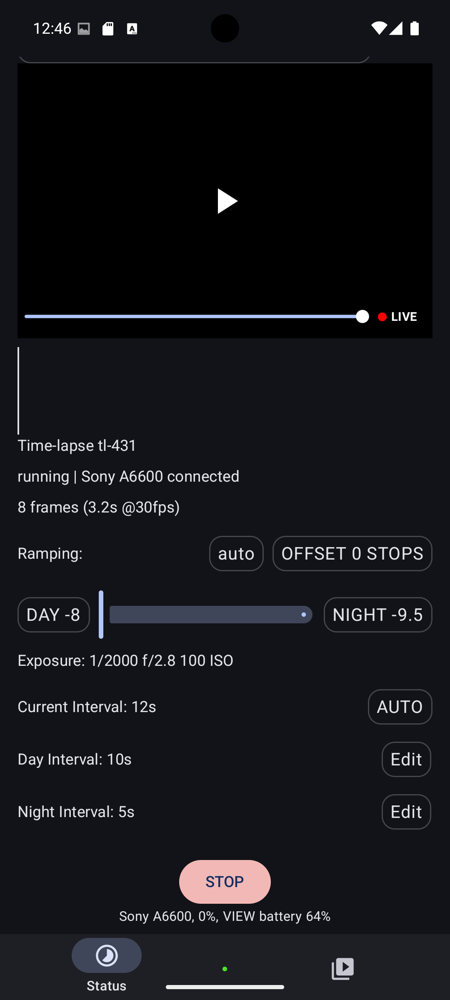
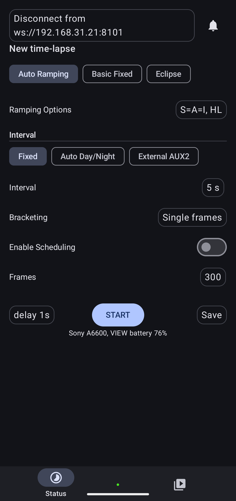
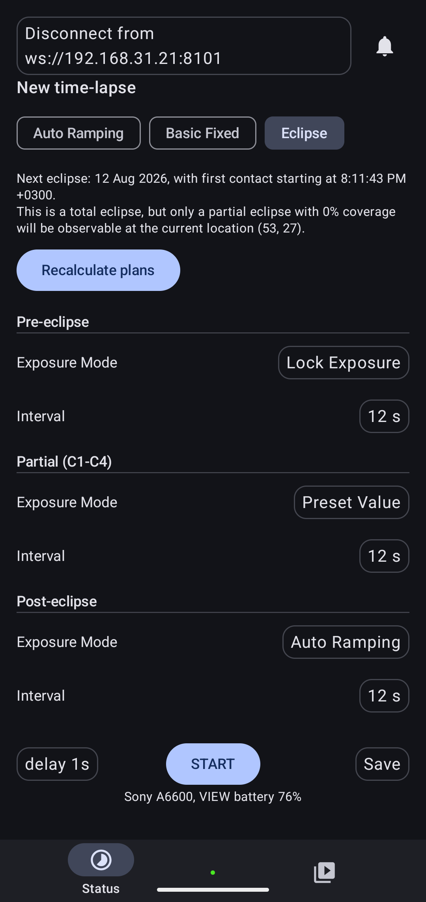
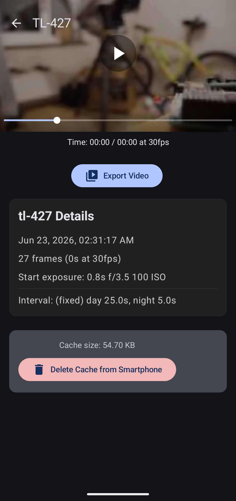
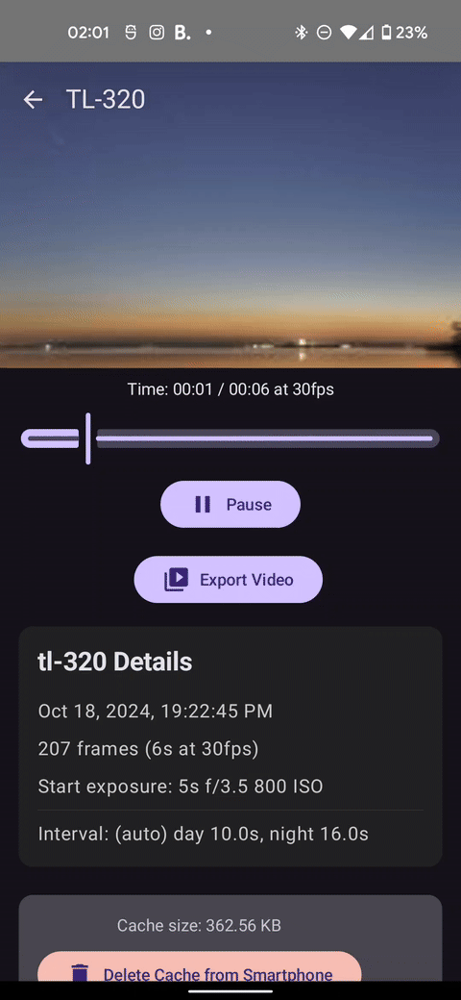

# ViewApp

ViewApp is an unofficial Android app for the **Timelapse+ VIEW** intervalometer. It requires custom
VIEW firmware available here: [VIEW Releases](https://github.com/naixx/VIEW/releases/latest). Please
install the latest version (**1.8.55+**; the app also works with 1.8.54).

The app works only on local networks — either the VIEW's own Wi-Fi hotspot or a shared Wi-Fi. It does
**not** connect to the remote `app.view.tl` host. The new firmware can still connect to the remote host
and works as before, and the original app continues to work as before too.

## Features

- **Create & launch time-lapses** straight from the app — Auto Ramping, Basic Fixed, and Eclipse
  modes, with ramping options, bracketing/HDR, delay-start, scheduling, and saved programs.
- **Edit a running time-lapse live** — adjust frames, ramp mode, brightness/EV offsets, and interval
  mid-capture, ramped smoothly over a chosen number of frames.
- **Persisted, self-restoring connection** — a foreground service keeps the WebSocket alive and saves
  thumbnails for the running time-lapse even when the app is in the background.
- **Local clip browser** — clips are cached on the phone for much faster access, with **MP4 export** to
  share a preview.
- **YouTube-style seek bar** — overlay scrubber with tap-to-seek and a "go live" pill while capturing.

## Motivation

During long day/night time-lapses, I found the original app's connection to the device pretty unstable.
In ViewApp I've implemented a persisted, self-restored connection. Even if the app is in the
background, thumbnails are saved for the currently running time-lapse.

Another feature is that clips can be stored on the smartphone, making download times for them much
faster. You can also export a clip as an MP4 file to share a preview.

## Installation

Download an APK from the [ViewApp Releases](https://github.com/naixx/viewapp/releases/latest) and
install it on your phone.

## Development

If you want to build the app yourself, create a `secrets.properties` file in the root directory with
your credentials (use `secrets.properties.template` as a reference).

See [CHANGELOG.md](CHANGELOG.md) for what's changed between releases.
